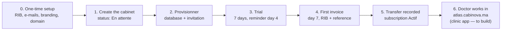

# From creating a cabinet to the cabinet ready to work

Example used throughout: **"Cabinet Atlas", Dr. Benali, Rabat, Pro offer, monthly (599 MAD), 7-day trial.**

## 0. Before your first real cabinet (one-time setup)

- **Facturation → Paramètres:** your real RIB and company details (today it still has the test RIB, and every invoice would carry it).
- **Configuration → E-mails:** a Resend key and a sending domain. **Without them, no e-mail actually leaves**: not the doctor's invitation, not the invoices.
- **Configuration → Général / Identité visuelle:** support contact, logo and colour (they appear in every e-mail).
- **Hosting and the `*.cabinova.ma` domain**, so that `atlas.cabinova.ma` actually opens.

## 1. Create the cabinet (Cabinets → Nouveau cabinet)

You enter the identity (name, doctor, city, e-mail, phone), the subdomain `atlas`, the offer **Pro**, monthly billing, and the trial (7 days by default, from the offer; it can start on a chosen date).

On saving:

- The cabinet is created with status **En attente**.
- Its limits are copied from Pro: 1 doctor, 3 secretaries, 20 GB.
- A subscription starts **in trial**, from today until day 7. **The trial clock starts at creation, not at activation.**
- Its language and time zone come from Configuration.
- Everything is recorded in the journal.

## 2. Set up its database (Technique tab → Provisionner)

One click runs 6 steps, which you can watch live:

1. **Database creation** on Neon: a database and an access account just for Atlas. The password is encrypted in the admin.
2. **Schema:** the clinic tables are created.
3. **Clinic profile and the doctor's account** inside that database.
4. **Connection test.**
5. **Invitation:** an e-mail to Dr. Benali with a link `https://atlas.cabinova.ma/invite/…`, valid 7 days, to choose a password.
6. **Activation:** status becomes **Actif**, and your team gets the "Cabinet prêt" notification.

If a step fails, the cabinet goes back to "En attente" with the error shown, and you can run it again.

From then on, the database is checked automatically every 10 minutes: response and size against the 20 GB. You're alerted if it stops responding or nears its quota.

## 3. The trial (day 0 → day 7)

- Atlas uses everything **Pro** includes: agenda, records, prescriptions, statistics, limited SMS reminders. Exceptions per cabinet are possible (Fonctionnalités tab).
- **Day 4:** automatic e-mail "your trial ends on …", with the price that follows (599 MAD/month).
- To give a discount, apply a **promo code** or a commercial discount from the Abonnement tab before the trial ends.

## 4. End of trial → first invoice (day 7)

The hourly billing check:

- issues **F-2026-000001** (599 MAD, or less with a code or credit);
- e-mails it to the doctor with your RIB and the reference to put on the transfer;
- marks the subscription "En attente de paiement". The invoice is due **7 days later**.

## 5. The doctor pays

1. They transfer 599 MAD with the reference F-2026-000001.
2. When it shows on your statement: invoice → **Enregistrer le virement**.
3. The invoice is "Payée", the subscription becomes **Actif** until next month, and the doctor gets a receipt.
4. Each month after that, the next invoice goes out **7 days before** the renewal date, and so on.

**If they don't pay:**

| When | What happens |
|---|---|
| Due date + 7 days | "En retard" + reminder; your team is alerted |
| Due date + 12 days | Last warning: "access suspended on …" |
| Due date + 15 days | **Automatic suspension**; data kept |
| Transfer recorded | **Automatic reactivation** |

## 6. "Ready to work in its space": what's still missing

Everything on the Super Admin side is ready, but the **clinic app doesn't exist yet**. So today:

- Dr. Benali's invitation link points to `atlas.cabinova.ma/invite/…`, but nothing answers there yet: no clinic app is built and no hosting is set up.
- Login, agenda, patients, and inviting their own secretaries will all live in that clinic app, built next.

## Also part of the path

- **Support:** if Atlas calls, you open a ticket from their Support tab; replies are e-mailed to them.
- **Journal:** each step (creation, provisioning, invoices, payments, status changes) is recorded in Sécurité.
- **Notifications:** your team sees cabinet ready, failed setup, overdue invoice and suspension live on the bell.
