# كابينوفا — دليل لوحة الإدارة العامة (Super Admin)

> هذا المستند يشرح بالتفصيل كل ما تم بناؤه حتى الآن في الجزء الخاص بالإدارة العامة لمنصة **Cabinova**: الوحدات، الشاشات، السيناريوهات، والقواعد التي تعمل خلف الكواليس.
>
> أسماء الشاشات والأزرار مكتوبة بالفرنسية بين قوسين كما تظهر في التطبيق، حتى تتعرف عليها بسهولة.
>
> **ملاحظة حول الرسوم البيانية:** الرسوم مكتوبة بصيغة Mermaid. في Notion تظهر ككتلة كود؛ اختر من قائمة الكتلة **Mermaid** ثم **Preview** (أو **Split**) لعرض الرسم.

---

## فهرس المحتويات

1. نظرة عامة على المنصة
2. البنية التقنية
3. الأدوار والصلاحيات (Utilisateurs)
4. تسجيل الدخول والمصادقة الثنائية
5. الوحدة 1 — لوحة القيادة (Tableau de bord)
6. الوحدة 2 — إدارة العيادات (Cabinets)
7. الوحدة 3 — العروض والاشتراكات والفوترة (Offres, Facturation)
8. الوحدة 4 — الإدارة التقنية (Technique)
9. الوحدة 5 — المستخدمون المركزيون (Utilisateurs)
10. الميزات والخيارات (Fonctionnalités)
11. الدعم والمساعدة (Support)
12. الأمان والامتثال (Sécurité)
13. الإعدادات العامة (Configuration)
14. الرسائل الإلكترونية التلقائية
15. المهام التلقائية التي تعمل في الخلفية
16. ما تبقى والقرارات المنتظرة

---

## 1. نظرة عامة على المنصة

**Cabinova** منصة SaaS لإدارة العيادات والعيادات الطبية الخاصة في المغرب (واجهة بالفرنسية). كل عيادة تشترك في المنصة وتحصل على:

- **مساحة خاصة بها** على عنوان مثل `cabinet-x.cabinova.ma`.
- **قاعدة بيانات مستقلة تماماً** (قاعدة بيانات لكل عيادة — *database per tenant*)، حتى لا تختلط بيانات المرضى بين العيادات أبداً.

المنصة تتكون من جزأين:

| الجزء | لمن؟ | الحالة |
|---|---|---|
| **لوحة الإدارة العامة (Super Admin)** | أنت وفريقك: إدارة العيادات، الاشتراكات، الفوترة، الدعم، الأمان… | ✅ مبنية (موضوع هذا المستند) |
| **تطبيق العيادة (Clinique)** | الطبيب والسكرتيرة: المواعيد، ملفات المرضى، الوصفات… | ⏳ المرحلة القادمة |

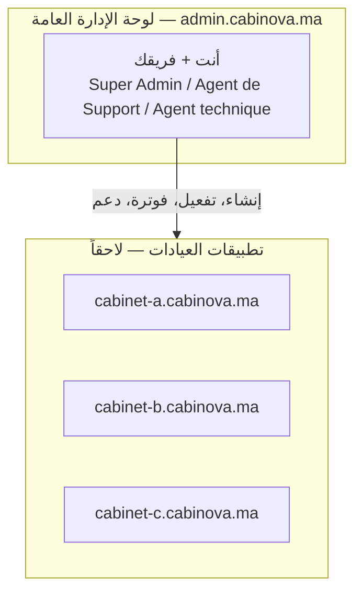

**مبدأ أساسي:** لوحة الإدارة **لا تقرأ أبداً البيانات الطبية للمرضى**. هي تدير العيادات (الاسم، العقد، الاشتراك، الحالة التقنية) فقط.

---

## 2. البنية التقنية

### المكونات

| المكون | الدور |
|---|---|
| **admin-web** (Next.js) | الواجهة التي تستعملها في المتصفح |
| **admin-api** (NestJS) | الخادم: كل القواعد، الصلاحيات، الفوترة، المهام التلقائية |
| **قاعدة الكتالوج (Catalogue)** | قاعدة واحدة تحتوي: العيادات، الاشتراكات، الفواتير، المستخدمين المركزيين، سجل التدقيق، الإعدادات… |
| **قواعد العيادات** | قاعدة مستقلة لكل عيادة على Neon (PostgreSQL)، تُنشأ تلقائياً |

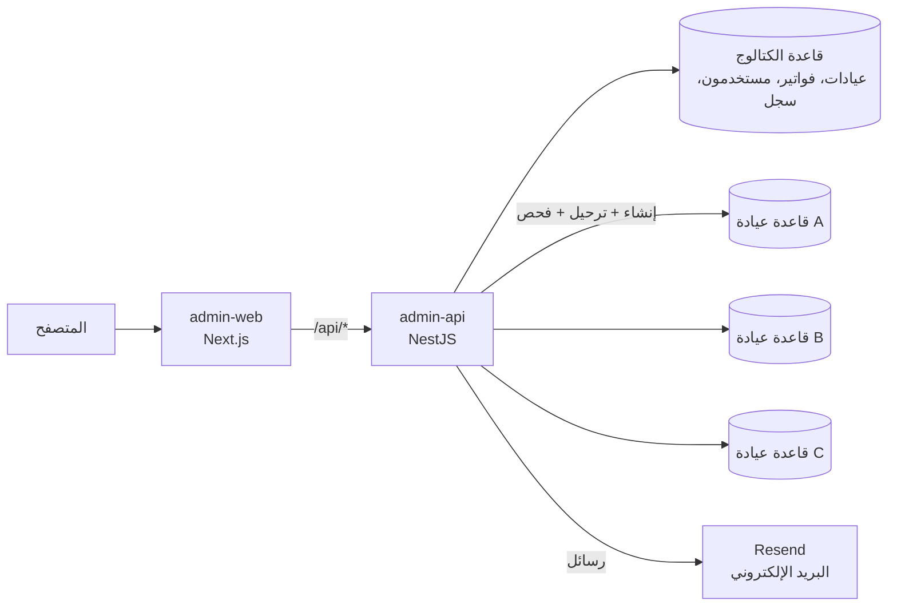

### الحماية التقنية الأساسية

- **كلمات مرور قواعد العيادات مشفّرة** في الكتالوج بخوارزمية AES-256-GCM بمفتاح رئيسي (`TENANT_SECRETS_KEY`) لا يُخزن أبداً في الكود.
- **عزل تام:** كل عيادة لها دور (role) خاص في قاعدة البيانات لا يستطيع الاتصال بقواعد العيادات الأخرى.
- **تحديد عدد الطلبات:** 600 طلب في الدقيقة لكل مستخدم، و10 محاولات في الدقيقة لرمز المصادقة الثنائية.
- **رؤوس أمان** على كل الصفحات (منع التضمين في مواقع أخرى، إلخ).

---

## 3. الأدوار والصلاحيات

### الأدوار الثلاثة

المنصة فيها **ثلاثة أدوار فقط** (لا يمكن إضافة أو حذف أدوار، لكن يمكن تعديل صلاحياتها):

| الدور | المهمة | الصلاحيات الافتراضية |
|---|---|---|
| **Super Admin** | الإدارة الشاملة | كل الصلاحيات (دائماً) |
| **Agent de Support** | التشخيص ومساعدة العيادات | لوحة القيادة، رؤية العيادات، الدعم (قراءة + معالجة) |
| **Agent technique** | قواعد البيانات، الترحيل، الصحة التقنية | لوحة القيادة، رؤية العيادات، التقني (قراءة + كتابة) |

### قائمة الصلاحيات (17 صلاحية)

| الصلاحية | المعنى |
|---|---|
| `dashboard:read` | رؤية لوحة القيادة |
| `tenants:read` / `tenants:write` | رؤية العيادات / إنشاؤها وتعديلها وتغيير حالتها |
| `tenants:data` | تصدير بيانات عيادة وحذفها نهائياً |
| `subscriptions:read` / `subscriptions:write` | رؤية العروض والاشتراكات / إدارتها (والأكواد الترويجية) |
| `billing:read` / `billing:write` | رؤية الفوترة / تسجيل التحويلات، الإلغاء، الإشعارات الدائنة |
| `technical:read` / `technical:write` | رؤية الحالة التقنية / الإنشاء، الترحيل، الفحص |
| `users:read` / `users:write` | رؤية المستخدمين المركزيين / دعوتهم وإدارتهم |
| `support:read` / `support:write` | رؤية التذاكر / معالجتها |
| `security:read` | سجل التدقيق والأحداث الحساسة |
| `settings:read` / `settings:write` | رؤية الإعدادات العامة / تعديلها |

### الاستثناءات الفردية

يمكن لكل مستخدم أن يحصل على **منح** (grant) أو **منع** (deny) لصلاحية معينة فوق صلاحيات دوره:

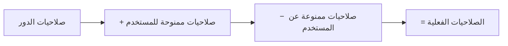

### الحمايات

- **لا تصعيد للصلاحيات:** لا يمكنك منح صلاحية لا تملكها أنت.
- **آخر Super Admin محمي:** لا يمكن تعطيله أو نزع دوره.
- **لا إغلاق ذاتي:** لا يمكنك نزع صلاحية إدارة المستخدمين عن نفسك.
- **القائمة الجانبية تتكيف:** كل مستخدم يرى فقط الصفحات المسموحة له.

---

## 4. تسجيل الدخول والمصادقة الثنائية

### الجلسات

- خانة "Se souvenir de moi" مُفعّلة → الجلسة تدوم **30 يوماً**.
- غير مُفعّلة → جلسة المتصفح، **12 ساعة** كحد أقصى.
- يمكن رؤية الأجهزة المتصلة وإغلاق الجلسات الأخرى من صفحة المستخدم.

### المصادقة الثنائية (2FA)

بعد كلمة المرور، يطلب التطبيق **رمزاً من 6 أرقام** من تطبيق مصادقة (Google Authenticator، Authy…). كل مستخدم يفعّلها من: القائمة → **Sécurité du compte**.

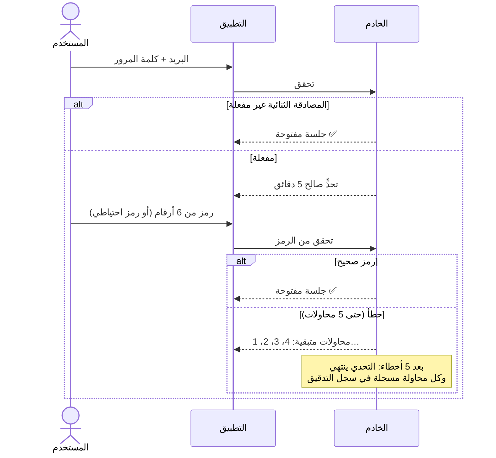

**التفعيل:** مسح رمز QR ← إدخال رمز للتأكيد ← الحصول على **10 رموز احتياطية** (للتحميل أو النسخ)، كل رمز يُستعمل مرة واحدة.

**سيناريو — فقدان الهاتف:** مستخدم فقد هاتفه ورموزه الاحتياطية. يتحقق الـ Super Admin من هويته، ثم من صفحة المستخدم ← **Actions → Réinitialiser la double authentification**. تُحذف المصادقة الثنائية وتُغلق كل جلساته؛ يدخل بكلمة المرور ثم يعيد تفعيلها.

---

## 5. الوحدة 1 — لوحة القيادة (Tableau de bord)

### ما تعرضه

| العنصر | المحتوى |
|---|---|
| **المؤشرات (KPI)** | عدد العيادات حسب الحالة، الجدد خلال 30 يوماً، الاشتراكات (تجربة/نشط/بانتظار الدفع)، **الإيراد الشهري المتكرر** (MRR) |
| **الفوترة** | **المفوتر** هذا الشهر، **المحصّل** فعلاً، **غير المدفوع** — ثلاثة أرقام منفصلة لا تُجمع أبداً (شرط من المواصفات) |
| **رسم بياني شهري** | الاشتراكات الجديدة مقابل الإلغاءات |
| **رسم دائري** | توزيع العيادات حسب العرض |
| **التوزيعات** | حسب المدينة والتخصص |
| **التنبيهات** | كل ما يحتاج تدخلاً، مرتبة حسب الخطورة |

### المرشحات (Filtres)

فترة الإنشاء، الحالة، المدينة، التخصص، العرض. **التنبيهات لا تتأثر بالمرشحات** (حتى لا يختفي حادث مهم).

### التنبيهات الحالية

| التنبيه | الخطورة |
|---|---|
| قواعد عيادات لا تستجيب | 🔴 حرج |
| ترحيلات فاشلة | 🔴 حرج |
| حوادث مفتوحة (دعم) | 🔴 حرج |
| إنشاء (provisioning) فاشل | 🟠 تحذير |
| قواعد متأخرة في الترحيل | 🟠 تحذير |
| تذاكر بدون رد خارج المهلة | 🟠 تحذير |
| تخزين قريب من الحصة (≥ 90%) | 🟠 تحذير |
| عيادات بفواتير غير مدفوعة | 🟠 تحذير |
| تجارب تنتهي خلال 3 أيام | 🔵 معلومة |
| تغييرات حالة مبرمجة خلال 7 أيام | 🔵 معلومة |

### التصدير

- **Excel**: نفس الأرقام بصيغة CSV.
- **PDF**: تقرير جاهز للطباعة (المؤشرات، الحالات، التطور الشهري، التوزيعات، التنبيهات) مع المرشحات المطبقة، يُحفظ PDF من نافذة الطباعة.

> ⏳ **"العيادات غير النشطة"** تحتاج بيانات الدخول من تطبيق العيادة — ستأتي معه.

---

## 6. الوحدة 2 — إدارة العيادات (Cabinets)

### بيانات العيادة

الاسم، الاسم القانوني، المعرّف التقني (slug)، التخصص، الطبيب المسؤول، العنوان، المدينة، الهاتف، البريد، النطاق الفرعي، الحصص (عدد الأطباء، السكرتيرات، المستخدمين، التخزين).

### دورة حياة العيادة

كل تغيير في الحالة يمر عبر **انتقال مسمّى** له قواعد: من أي حالة يمكن البدء، ولماذا (سبب إلزامي).

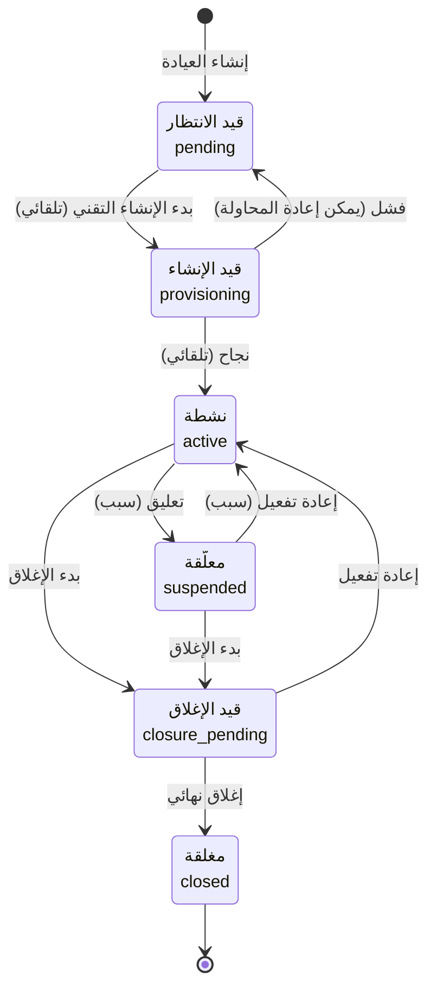

### أسباب التغيير

| الانتقال | الأسباب الممكنة |
|---|---|
| **تعليق** | عدم الدفع، طلب المالك، احتيال، حادث أمني، خرق العقد، تعليق مؤقت من الدعم |
| **إعادة تفعيل** | تسوية الدفع، حل الحادث، طلب المالك، أخرى |
| **بدء الإغلاق** | طلب المالك، إغلاق مؤقت، نهاية العقد، عدم الدفع، أخرى |
| **إغلاق** | انتهاء فترة الإغلاق، طلب المالك، أخرى |

### سيناريو — تعليق مبرمج

العيادة طلبت التوقف بداية الشهر القادم:
1. **Statut → Suspendre**، السبب: "طلب المالك"، التاريخ: 1 من الشهر القادم، مع رسالة.
2. يظهر شريط في صفحة العيادة: "تعليق مبرمج يوم …" مع زر إلغاء.
3. في التاريخ، يُطبق التعليق تلقائياً (فحص كل دقيقة)، ويصل بريد للطبيب المسؤول إن طُلب ذلك.

### صفحة العيادة

في الأعلى **بطاقات سريعة**: العرض، الاشتراك، الفواتير، قاعدة البيانات (مع حجمها)، الميزات. ثم تبويبات:

| التبويب | المحتوى |
|---|---|
| **Informations** | الهوية، الاتصال، الحصص، النطاق |
| **Abonnement** | الاشتراك، الكود الترويجي، الرصيد الدائن، الفواتير، الإشعارات الدائنة |
| **Fonctionnalités** | الميزات المتاحة واستثناءات العيادة |
| **Support** | تذاكر العيادة |
| **Technique** | قاعدة البيانات، الصحة، التخزين، الإنشاء |
| **Données** | تصدير البيانات والحذف النهائي |
| **Audit** | كل التغييرات الإدارية على العيادة |

> العيادة **المغلقة** للقراءة فقط: لا تعديل ولا انتقالات.

---

## 7. الوحدة 3 — العروض والاشتراكات والفوترة

### العروض (Offres)

| | Starter | Pro | Enterprise |
|---|---|---|---|
| **السعر الشهري** | 299 درهم | 599 درهم | 1 199 درهم |
| **السعر السنوي** | 2 990 درهم | 5 990 درهم | 11 990 درهم |
| **أيام التجربة** | 7 | 7 | 7 |
| **الأطباء** | 1 | 1 | غير محدود |
| **السكرتيرات** | 1 | 3 | 10 |
| **المستخدمون** | 2 | 4 | غير محدود |
| **التخزين** | 5 جيجا | 20 جيجا | 100 جيجا |

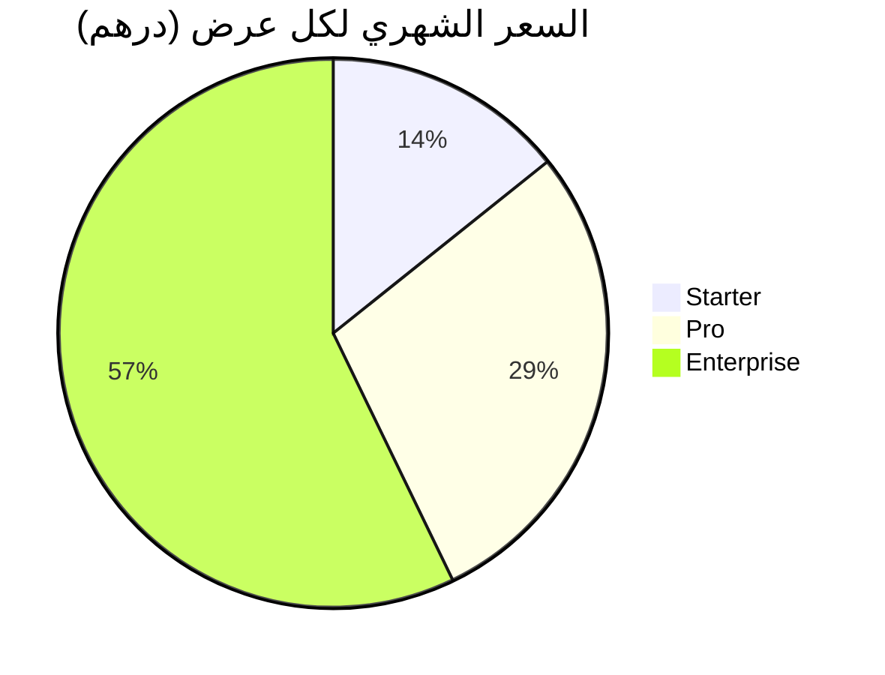

- يمكن إنشاء عروض جديدة (مع قوالب جاهزة)، تعديلها، أو **أرشفتها** (تبقى للعيادات الحالية لكن لا تُختار مجدداً).
- **سعر الاشتراك محفوظ** عند البدء: تغيير سعر العرض لاحقاً لا يؤثر على العيادات الحالية.
- **خصم تجاري** (0–100%) لكل اشتراك.

### طريقة الدفع: تحويل بنكي إلى حسابك (RIB) فقط

لا يوجد دفع بالبطاقة. المبدأ:

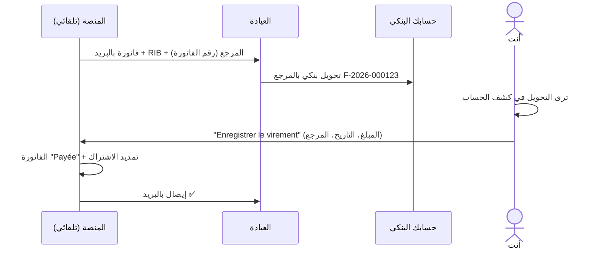

### الفواتير

- **ترقيم:** `F-2026-000001` تسلسلي، لا يُعاد استعماله أبداً.
- **الحالات:** À payer (للدفع) · En retard (متأخرة) · Payée (مدفوعة) · Annulée (ملغاة) · Remboursée (مستردة).
- **فاتورة غير مدفوعة واحدة كحد أقصى** لكل اشتراك (لا تكرار).
- **وثيقة للطباعة/PDF** لكل فاتورة: المُصدر، العيادة، السطر، RIB، المدفوعات، الإشعارات الدائنة.
- **إلغاء** فاتورة غير مدفوعة (خطأ في المبلغ…) مع سبب.

### حالات الاشتراك

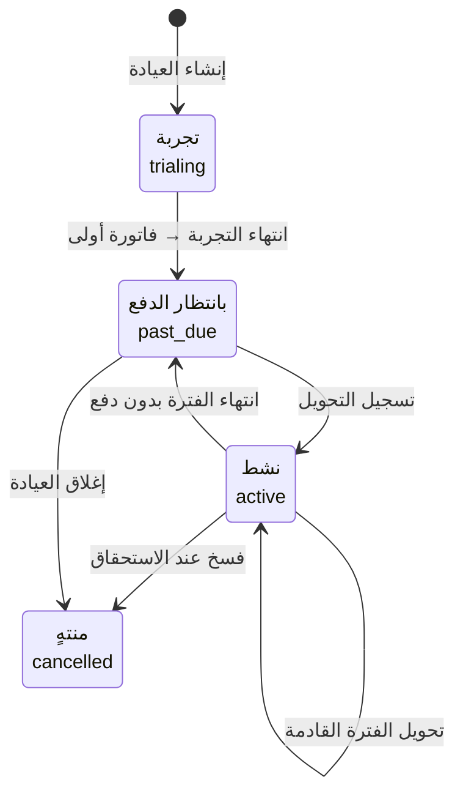

### الجدول الزمني للفوترة وعدم الدفع

الإعدادات في **Facturation → Paramètres** (القيم الحالية بين قوسين):

| الإعداد | المعنى |
|---|---|
| **Facturer le renouvellement** (7 أيام) | إرسال فاتورة التجديد قبل نهاية الفترة |
| **Délai de paiement** (7 أيام) | بعدها تصبح الفاتورة "متأخرة" |
| **Rappel de fin d’essai** (3 أيام) | تذكير قبل نهاية التجربة |
| **Suspension automatique** (15 يوماً) | تعليق تلقائي بعد تاريخ الاستحقاق؛ 0 = يدوي فقط |

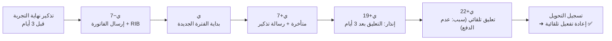

### سيناريو — عدم الدفع ثم الدفع

1. فاتورة عيادة "الأمل" تصبح متأخرة. تصلها رسالة تذكير، ويصل فريقك تنبيه (إن كان مفعلاً).
2. بعد 12 يوماً من التأخر: **إنذار أخير** — "سيتم تعليق الوصول يوم …".
3. بعد 15 يوماً: العيادة **معلّقة تلقائياً** بسبب "عدم الدفع"، مع رسالة لها وتنبيه لفريقك. بياناتها محفوظة.
4. العيادة تحوّل المبلغ. تسجّل التحويل ← **تُعاد تفعيلها تلقائياً**.

> 🔒 **حماية:** إعادة التفعيل التلقائية تحدث **فقط** إذا كان التعليق بسبب عدم الدفع، وليس هناك فواتير متأخرة أخرى. عيادة معلّقة بسبب احتيال أو حادث أمني **لا تُعاد تفعيلها أبداً** بمجرد الدفع.

### الإشعارات الدائنة (Avoirs)

على فاتورة **مدفوعة** فقط (الفاتورة غير المدفوعة تُلغى). كامل أو جزئي، حتى المبلغ المدفوع غير المُعاد بعد.

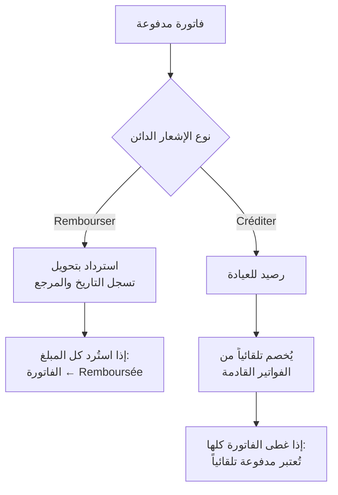

- **ترقيم:** `A-2026-000001`.
- **سيناريو:** عيادة دفعت 269,10 درهم ونريد خصماً تجارياً 100 درهم ← إشعار دائن "Créditer" ← الفاتورة القادمة تصبح **169,10 درهم** مع سطر "avoir déduit : 100,00 MAD".

### الأكواد الترويجية (Codes promo)

في **Offres → Codes promo**:

| الخاصية | مثال |
|---|---|
| الكود | `LANCEMENT2026` |
| نسبة الخصم | 30% |
| المدة | عدد الفواتير (مثلاً 2) أو طوال الاشتراك |
| صالح حتى | تاريخ (اختياري) |
| الحد الأقصى للاستعمال | عدد (اختياري) |
| العروض المعنية | كلها أو بعضها |

- يُطبق من تبويب **Abonnement** في صفحة العيادة.
- **مرة واحدة لكل عيادة**.
- **لا تراكم:** يُطبق الأفضل بين الخصم التجاري والكود.
- **"Prochaine facture"** يعرض المبلغ الحقيقي بعد الكود والرصيد الدائن.

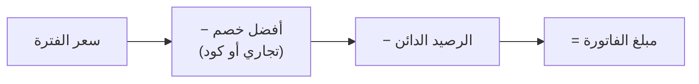

### معلومات المُصدر (Facturation → Paramètres)

اسم الشركة، العنوان، البريد، ICE، RC، IF، صاحب الحساب، البنك، **RIB** (24 رقماً مع التحقق والتقسيم)، SWIFT، مع **معاينة مباشرة** لكتلة الدفع كما تظهر في الفواتير والرسائل.

---

## 8. الوحدة 4 — الإدارة التقنية (Technique)

### قاعدة بيانات لكل عيادة

عند إنشاء عيادة، يمكن إنشاء قاعدتها تلقائياً بضغطة. الخطوات:

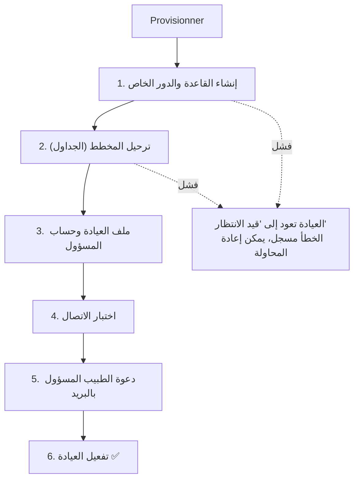

كل خطوة تظهر مباشرة في صفحة العيادة (تبويب Technique) مع حالتها.

### الصفحة التقنية العامة

- **أسطول القواعد:** كل القواعد مع الحالة، الإصدار، زمن الاستجابة.
- **الترحيل الشامل:** تطبيق آخر إصدار من المخطط على كل القواعد المتأخرة؛ فشل عيادة لا يوقف الأخرى.
- **فحص الصحة:** تلقائياً كل **10 دقائق**، أو يدوياً بزر "Tester la connexion".

### التخزين مقابل الحصة

كل فحص صحة يقيس **حجم قاعدة البيانات** ويعرضه مقابل حصة العرض (مثلاً `7,5 Mo / 5 Go`) مع شريط ملوّن:

| النسبة | اللون |
|---|---|
| أقل من 75% | 🟢 أخضر |
| 75% – 90% | 🟠 برتقالي |
| 90% فأكثر | 🔴 أحمر + تنبيه في لوحة القيادة |

> الملفات المرفوعة (صور، وثائق) ستُضاف للحساب مع تطبيق العيادة.

### تنبيه "قاعدة لا تستجيب"

عندما تتوقف قاعدة كانت تعمل عن الاستجابة: تسجيل في السجل + تنبيه في لوحة القيادة + بريد لفريقك (إن كان مفعلاً).

---

## 9. الوحدة 5 — المستخدمون المركزيون (Utilisateurs)

هم أعضاء **فريقك** (وليس موظفي العيادات، الذين سيكونون في قاعدة كل عيادة).

### سيناريو — دعوة عضو جديد

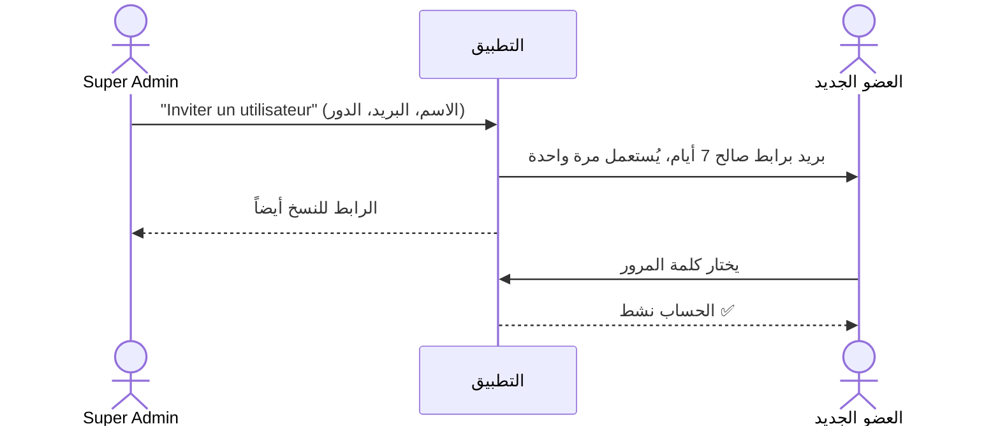

### الإجراءات المتاحة على كل مستخدم

- إعادة إرسال الدعوة / رابط كلمة مرور جديدة (الروابط السابقة تتوقف).
- إغلاق كل جلساته.
- إعادة تعيين المصادقة الثنائية.
- تعطيل الحساب (يُغلق كل جلساته، ويبقى تاريخه) أو إعادة تفعيله.
- تعديل الأدوار والاستثناءات.

### المؤشرات في القائمة

الحالة (نشط / مدعو / معطل)، **2FA** أو **Sans 2FA**، آخر اتصال.

---

## 10. الميزات والخيارات (Fonctionnalités)

### كتالوج الميزات

| الميزة | الفئة |
|---|---|
| إدارة المواعيد | Agenda |
| الملفات الطبية | Dossier patient |
| الوصفات | Dossier patient |
| الإحصائيات المتقدمة | Pilotage |
| تذكيرات SMS / واتساب | Communication |
| عدة أطباء | Organisation |
| عدة مواقع | Organisation |
| الدعم ذو الأولوية | Service |

### مستويات الميزة في كل عرض

`included` (مضمّنة) · `limited` (محدودة) · `addon` (خيار مدفوع) · `custom` (حسب العقد) · `none` (غير متاحة)

### حالة الميزة على مستوى المنصة

- **active** — عادية.
- **beta** — تجريبية، فقط للعيادات المختبِرة.
- **disabled** — **مفتاح إيقاف** فوري لكل العيادات (عند حادث) مع سبب.

### استثناءات لكل عيادة

يمكن منح عيادة ميزة (أو منعها) مع **تاريخ بداية ونهاية** اختياري — مثلاً تجربة مجانية للتذكيرات لمدة شهر.

### كيف تُحسب الميزة الفعلية لعيادة؟

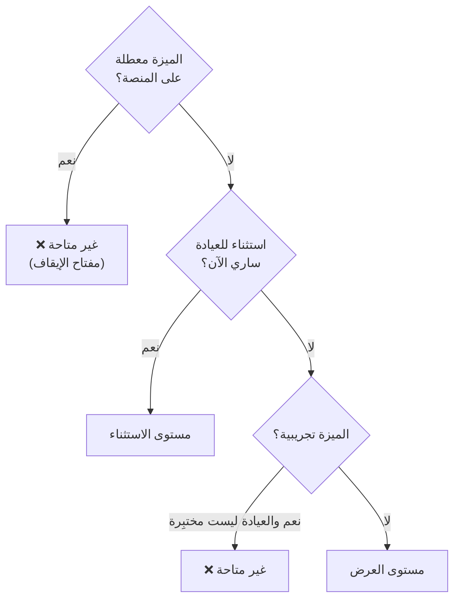

---

## 11. الدعم والمساعدة (Support)

### التذكرة

كل تذكرة لها رقم `T-000001`، عيادة (أو "كل المنصة" للحوادث)، نوع، أولوية، قناة، جهة اتصال، ومكلّف.

| النوع | المعنى |
|---|---|
| Assistance | سؤال أو صعوبة استعمال |
| Incident | شيء لم يعد يعمل |
| Configuration | إعداد مطلوب للعيادة |
| Facturation | فاتورة، دفع، اشتراك |

### دورة حياة التذكرة

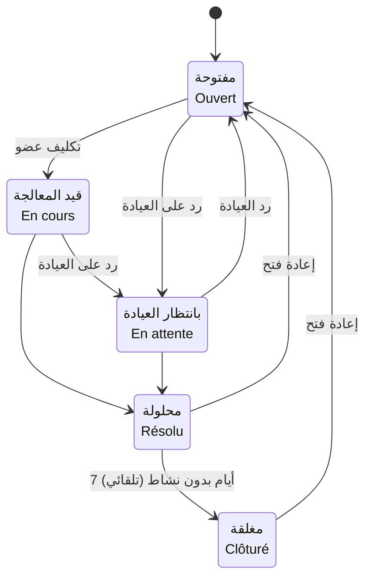

### مهلة الرد الأول (SLA)

| الأولوية | عادي | مع الدعم ذي الأولوية (Enterprise) |
|---|---|---|
| عاجلة | ساعتان | ساعة |
| عالية | 8 ساعات | 4 ساعات |
| عادية | 24 ساعة | 8 ساعات |
| منخفضة | 3 أيام | 24 ساعة |

### أنواع الرسائل في المحادثة

- **Répondre** — رد يُرسل للعيادة بالبريد (مع رقم التذكرة في العنوان).
- **Note interne** — ملاحظة داخلية لا تراها العيادة.
- **Réponse du cabinet** — تسجيل رد العيادة الذي وصل بالهاتف أو البريد.
- **أحداث** — تغييرات الحالة والأولوية والتكليف تظهر كأسطر صغيرة.

### سيناريو — مكالمة من عيادة

1. **Nouveau ticket**: النوع "Assistance"، العيادة، الموضوع، الوصف، القناة "Téléphone". (تُملأ جهة الاتصال تلقائياً من بيانات العيادة.)
2. اختيارياً: بريد **تأكيد استلام** للعيادة برقم التذكرة.
3. ترد ← البريد يُرسل، المهلة تُحتسب كمستوفاة، التذكرة تُكلّف بك، وتصبح "بانتظار العيادة".
4. العيادة تتصل مجدداً ← تسجل ردها ← التذكرة تعود "مفتوحة".
5. **Marquer résolu** ← تُغلق تلقائياً بعد 7 أيام.

### صفحة الدعم

العروض: À traiter · Les miens · Non assignés · Hors délai · En attente · Résolus · Tous، مع عدد لكل منها، ومرشحات النوع والأولوية والبحث. الحوادث المفتوحة تظهر كشريط أحمر في الأعلى.

> **حدّ حالي:** ردود العيادات بالبريد تصل إلى صندوق بريدك، ولا تُضاف تلقائياً للتذكرة؛ يسجلها فريقك عبر "Réponse du cabinet".

---

## 12. الأمان والامتثال (Sécurité)

### سجل التدقيق

**كل** إجراء مهم يُسجل: من، ماذا، متى، من أي عنوان IP، على أي عيادة، وما الذي تغيّر.

| الفئة | أمثلة |
|---|---|
| Connexions | دخول، فشل كلمة مرور، فشل رمز 2FA |
| Cabinets | إنشاء، تعديل، تغيير حالة، ميزات، إنشاء تقني |
| Données | تصدير، حذف نهائي |
| Facturation | فواتير، تحويلات، إلغاء، إشعارات دائنة، أكواد ترويجية |
| Offres | تعديل العروض |
| Fonctionnalités | الكتالوج، مفتاح الإيقاف |
| Support | تذاكر |
| Configuration | الإعدادات العامة |
| Utilisateurs | دعوات، صلاحيات، تعطيل، إعادة تعيين 2FA |

**الأحداث الحساسة** (⚠️) مثل: فشل الدخول، تعطيل 2FA، تغيير الصلاحيات، تغيير حالة عيادة، تصدير/حذف البيانات، تغيير RIB، تسجيل تحويل، إشعار دائن، تغيير إعدادات البريد.

### صفحة الأمان

- **ثلاثة أرقام:** محاولات الدخول الفاشلة (24 ساعة)، الحسابات المحمية بـ 2FA، الأحداث الحساسة (7 أيام).
- **الحسابات بدون 2FA**.
- **مدة الاحتفاظ بالبيانات**.
- **السجل الكامل** مع مرشحات (الفئة، الفترة، الكاتب، الحساسة فقط، بحث) و**تصدير Excel**.

### نهاية حياة العيادة: التصدير والحذف

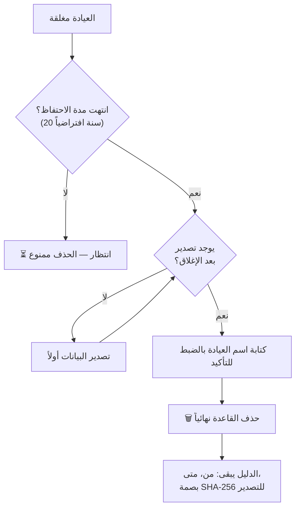

- **التصدير** (تبويب Données): كل جداول قاعدة العيادة في ملف JSON مضغوط؛ كلمات المرور والرموز مستبعدة؛ **بصمة SHA-256** محفوظة كدليل على ما سُلّم.
- **الحذف** لا يحدث تلقائياً أبداً: ثلاثة شروط (مغلقة + انتهاء الاحتفاظ + تصدير بعد الإغلاق) + تأكيد بالاسم.
- **مدة الاحتفاظ** (20 سنة) قيمة حذرة؛ يجب تأكيدها حسب القانون المغربي للملفات الطبية.

---

## 13. الإعدادات العامة (Configuration)

| القسم | المحتوى | أين يُستعمل |
|---|---|---|
| **Général** | اسم المنصة، بريد وهاتف الدعم، الموقع، المنطقة الزمنية الافتراضية | الدخول، القائمة، الفواتير، أسفل كل بريد، العيادات الجديدة |
| **Identité visuelle** | الشعار (PNG/JPEG، 200 كيلوبايت) واللون الرئيسي، مع معاينة وتحذير التباين | صفحة الدخول، القائمة، الفواتير، الرسائل |
| **E-mails** | اسم المرسل، عنوان الإرسال، عنوان الرد، التوقيع، زر بريد تجريبي | كل الرسائل |
| **Notifications** | الرسائل التلقائية للعيادات، وتنبيهات الفريق ومستلموها | الفوترة، الدعم، التقني |
| **Paiements** | ملخص RIB والمهل، مع رابط للتعديل | الفوترة |
| **Langues** | اللغة الافتراضية للعيادات الجديدة (فرنسية/عربية/إنجليزية) واللغات المتاحة | العيادات الجديدة، وتطبيق العيادة لاحقاً |

كل تعديل يُسجل في سجل التدقيق.

---

## 14. الرسائل الإلكترونية التلقائية

| الرسالة | المستلم | متى | قابلة للإيقاف؟ |
|---|---|---|---|
| دعوة عضو فريق / رابط كلمة مرور | عضو الفريق | عند الدعوة أو الطلب | لا |
| دعوة الطبيب المسؤول | العيادة | نهاية الإنشاء التقني | خيار عند الإنشاء |
| تذكير نهاية التجربة | العيادة | قبل 3 أيام | ✅ |
| فاتورة جديدة + RIB | العيادة | عند الإصدار | ✅ |
| تذكير فاتورة متأخرة | العيادة | عند التأخر | ✅ |
| إيصال الدفع | العيادة | عند تسجيل التحويل | ✅ |
| إشعار دائن | العيادة | عند الإصدار | ✅ (مع الإيصالات) |
| إنذار قبل التعليق | العيادة | 3 أيام قبل التعليق | لا |
| إشعار التعليق لعدم الدفع | العيادة | عند التعليق | لا |
| تغيير حالة العيادة | العيادة | حسب الاختيار في النافذة | اختيار في كل مرة |
| تأكيد استلام تذكرة | العيادة | عند الإنشاء | اختيار في كل مرة |
| رد على تذكرة | العيادة | عند الرد | لا |
| تنبيه حادث / تذكرة عاجلة | الفريق | عند الإنشاء | ✅ |
| تنبيه قاعدة لا تستجيب | الفريق | عند التوقف | ✅ |
| تنبيه فاتورة متأخرة / تعليق | الفريق | عند الحدث | ✅ |

> ⚠️ حالياً لا يوجد مفتاح Resend: الرسائل **تُكتب في سجلات الخادم فقط** ولا تُرسل فعلاً.

---

## 15. المهام التلقائية التي تعمل في الخلفية

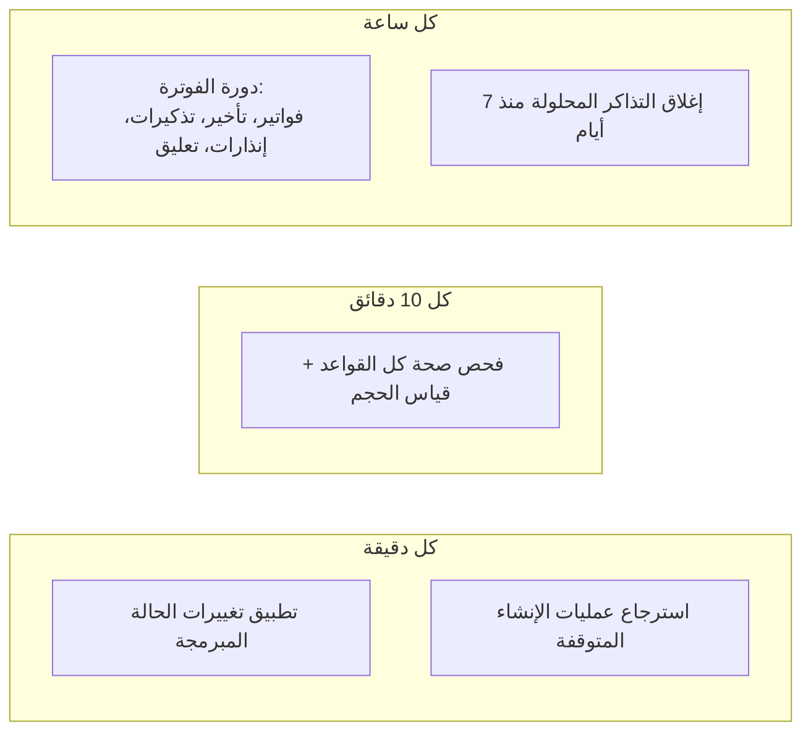

كل هذه المهام **آمنة للتكرار**: تشغيلها مرتين لا ينتج فواتير أو رسائل مكررة.

---

## 16. ما تبقى والقرارات المنتظرة

### ما يجب فعله قبل الإطلاق

| المهمة | الأولوية |
|---|---|
| حفظ العمل في Git (commit) | 🔴 عاجل |
| تحديث مكتبات بها ثغرات معروفة (body-parser, multer, zod, undici, fast-uri) | 🔴 |
| اختبارات آلية للمسارات المهمة + تكامل مستمر (CI) | 🟠 |
| تفعيل المصادقة الثنائية لحسابك | 🟠 |
| وضع RIB ومعلومات شركتك الحقيقية | 🟠 |
| مفتاح Resend ونطاق إرسال موثّق | 🟠 |
| الاستضافة، النطاق `*.cabinova.ma`، الترحيل عند النشر، حفظ الأسرار | 🟠 |
| حذف بيانات الاختبار (عيادات، فواتير، أكواد) | 🔵 |

### قرارات تنتظرك

| القرار | الخيارات |
|---|---|
| **النسخ الاحتياطي** | Cloudflare R2 · Amazon S3 · تاريخ Neon فقط |
| **النطاقات الخاصة للعيادات** | تعتمد على اختيار الاستضافة |
| **تنظيم Neon** | مشروع لكل عيادة، أم قواعد متعددة في مشروع واحد (الحالي) |

### المرحلة القادمة

بعد ذلك يكتمل جزء الإدارة العامة، ونبدأ **تطبيق العيادة**: المواعيد، ملفات المرضى، الوصفات، المستخدمون داخل العيادة — وهو ما سيكمل أيضاً: العيادات غير النشطة، التخزين الكامل مع الملفات، واستعمال الميزات الفعلي.
